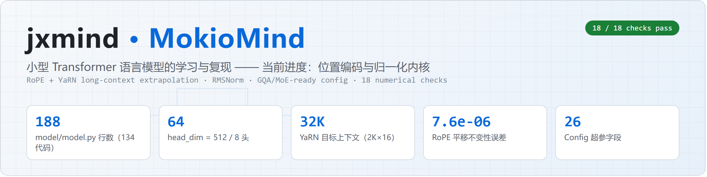
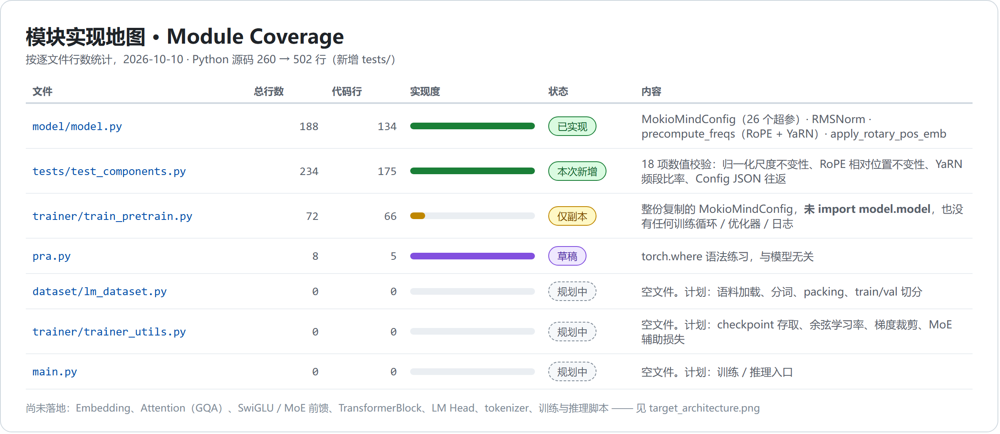
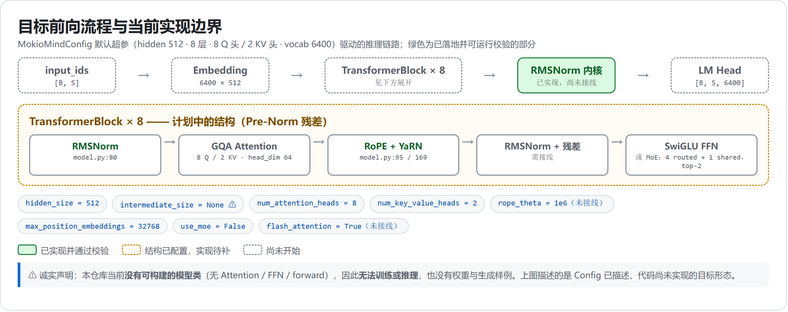
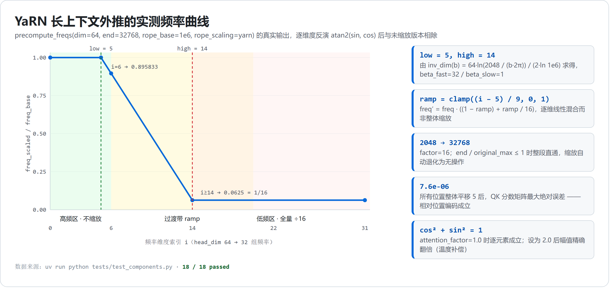

<div align="center">

# jxmind · MokioMind



**A small decoder-only Transformer language model, built up from the positional-encoding kernels.**
**Current stage: normalization + RoPE/YaRN core. Not yet a runnable model.**

</div>

---

## Status / 当前状态

> [!WARNING]
> **This repository cannot train or run inference yet.** There is no `Attention`, `FeedForward`,
> `TransformerBlock` or `LMHead` class, no tokenizer and no dataset loader. What exists is the
> numerical core (RMSNorm, RoPE with YaRN scaling) plus a config that describes a model which is
> not yet assembled. Every claim below is backed by a file, a line number, or a test that runs on
> this machine.
>
> 本仓库目前**不能训练、也不能推理**：没有 Attention / 前馈 / TransformerBlock / LM Head，也没有分词器与数据加载。
> 已落地的是数值内核（RMSNorm、带 YaRN 缩放的 RoPE）和一份描述"尚未拼装起来的模型"的配置。下文每条声明都能对应到文件、行号或一次真实运行。

---

## What is implemented / 已实现的部分

All of it lives in [`model/model.py`](model/model.py) — 188 lines, 134 of them code.
全部实现都在 [`model/model.py`](model/model.py) 里，共 188 行，其中代码行 134。

| Symbol | Location | What it does | Verified by |
| --- | --- | --- | --- |
| `MokioMindConfig` | [model.py:7](model/model.py#L7) | `PretrainedConfig` subclass, 23 explicit hyper-parameters, JSON round-trippable | `config_roundtrips_through_json` |
| `RMSNorm` | [model.py:80](model/model.py#L80) | Pre-norm with learnable per-dimension gain, fp16 in → fp16 out | 4 checks |
| `precompute_freqs` | [model.py:95](model/model.py#L95) | RoPE cos/sin table, with optional **YaRN** long-context scaling | `rope_cos_sin_are_unit_magnitude`, `rope_half_split_layout`, `yarn_*` (5) |
| `apply_rotary_pos_emb` | [model.py:169](model/model.py#L169) | Half-split rotation of Q/K, accepts a `[B,S,D]` table or `position_ids` | `rope_position_zero_is_identity`, `rope_shift_invariance_of_scores`, `rope_position_ids_matches_slicing`, `rope_output_shape_matches_query` |

> 上表四行即为本仓库的全部有效实现。校验列对应 [`tests/test_components.py`](tests/test_components.py)，
> 共 18 项断言，全部通过。

### Measured behaviour / 实测数值

| Property | Measured | Command |
| --- | --- | --- |
| RMS of `RMSNorm(x)` where `x ~ N(0, 50²)` | `1.0000` | `uv run python tests/test_components.py` |
| Max abs error of the QK score matrix after shifting every position by +5 | `7.63e-06` | same |
| YaRN frequency ratio for dims `i ≤ 5` (high freq) | `1.0` — untouched | same |
| YaRN frequency ratio for dims `i ≥ 14` (low freq) | `0.0625 = 1/16` | same |
| Default geometry | `head_dim = 512 / 8 = 64`, `8 Q heads / 2 KV heads` | `config_default_geometry` |

---

## Module coverage / 模块覆盖度



Three tracked files are **empty** and are kept deliberately as planned landing spots, per the
current roadmap: `main.py`, `dataset/lm_dataset.py`, `trainer/trainer_utils.py`.
`trainer/train_pretrain.py` contains a **verbatim copy** of `MokioMindConfig` rather than an import
from `model.model`, and holds no training loop. `pra.py` is a `torch.where` scratch file.

> 按当前规划，`main.py`、`dataset/lm_dataset.py`、`trainer/trainer_utils.py` 三个空文件作为后续落点保留。
> `trainer/train_pretrain.py` 目前是 `MokioMindConfig` 的**逐行副本**而非 `from model.model import ...`，且不含任何训练循环；
> `pra.py` 是 `torch.where` 练习草稿。这些都被列入下方"已知问题"。

---

## Target architecture and where the line sits / 目标架构与实现边界



> 绿色 = 已实现并通过校验；橙色虚线 = 配置里已描述、代码待补；灰色虚线 = 尚未开始。
> 图中链路是 `MokioMindConfig` 默认超参所**指向**的形态，不是当前可执行的计算图。

---

## RoPE + YaRN, in detail / 位置编码细节

`precompute_freqs` builds the standard RoPE frequencies `1 / (base^(2i/d))` and, when a `rope_scaling`
dict is supplied and `end / original_max > 1`, applies **YaRN**:

```
inv_dim(b) = d · ln(orig_max / (b · 2π)) / (2 · ln(base))
low, high  = floor(inv_dim(beta_fast)), ceil(inv_dim(beta_slow))
ramp(i)    = clamp((i − low) / (high − low), 0, 1)
freq'(i)   = freq(i) · ((1 − ramp) + ramp / factor)
```

With the config defaults (`d = 64`, `base = 1e6`, `orig_max = 2048`, `beta_fast = 32`,
`beta_slow = 1`, `factor = 16`) this yields `low = 5`, `high = 14` — measured, not assumed.



> 上图不是示意图，是把 `precompute_freqs` 的真实输出在 `t = 1` 处用 `atan2(sin, cos)` 逐维反演角度、
> 再与未缩放版本相除得到的实测曲线。`i ≤ 5` 比率严格为 1，`i ≥ 14` 严格为 `1/16`，中间 9 个维度线性过渡。
> 之所以用 `atan2` 而不是 `arccos`：高频维的角度接近 0，`arccos` 在该区间会损失全部浮点精度。

Two properties worth calling out, both asserted in the test suite:

- **Relative-position invariance.** Rotating all positions by a constant leaves the QK score matrix
  unchanged to within `7.6e-06`.
- **`attention_factor` is a uniform amplitude scale.** With `attention_factor = 2.0` every `cos`/`sin`
  entry doubles exactly; it compensates the flatter attention distribution at longer distances.

> 两点均由测试断言：整体平移位置不改变 QK 分数矩阵（相对位置编码成立）；`attention_factor` 是对 cos/sin 的均匀放大，
> 用于补偿长上下文下注意力分布变平。

---

## Quick start / 快速开始

```bash
# Python >= 3.13 required; this repo is developed on 3.14.6
uv sync                                          # installs torch 2.9.0, transformers 4.57.1
uv run python tests/test_components.py           # 18 numerical checks
uv run python pra.py                             # unrelated torch.where scratch
```

Expected tail of the test run:

```text
PASS  yarn_is_noop_within_original_window
PASS  yarn_leaves_high_freq_untouched
PASS  yarn_ramp_is_monotonic

18/18 passed
```

> `uv sync` 会按 `uv.lock` 从清华镜像安装依赖。仓库没有训练或推理入口，`main.py` 是空文件，
> 因此当前唯一可运行的东西就是这套校验脚本。

---

## Verification matrix / 校验矩阵

`tests/test_components.py` is dependency-free beyond `torch` + `transformers` and runs with or without
pytest.

| Group | Checks | What would break if it failed |
| --- | --- | --- |
| `rms_norm_*` | 4 | Scale-invariance lost, fp16 upcast, dead gradient through the norm |
| `rope_*` | 6 | Absolute instead of relative positions; silent shape explosion when a `[S, D]` table is passed |
| `yarn_*` | 5 | High-frequency dims wrongly interpolated, or scaling silently applied inside the trained window |
| `config_*` | 3 | Config not loadable by `transformers` from a checkpoint directory |

> 每组失败意味着什么，见表格第三列。测试脚本不依赖 pytest，直接 `python` 运行即可。

---

## Known issues / 已知问题

- `trainer/train_pretrain.py` duplicates `MokioMindConfig` instead of importing it — two copies will drift.
- `apply_rotary_pos_emb` previously accepted `position_ids` and ignored it; a `[S, D]` table also broadcast
  against the head dimension into a 5-D tensor **without raising**. Both are now handled and pinned by
  `rope_output_shape_matches_query`.
- `intermediate_size` defaults to `None` with no fallback, and is typed `int` rather than `Optional[int]`.
- `rope_theta` and `flash_attention` are stored on the config but read by nothing; `precompute_freqs`
  takes its own `rope_base` argument.
- Package name `mokiomind` (`pyproject.toml`) and class prefix `MokioMind` do not match the repo name `jxmind`.
- No tokenizer, dataset, training loop, checkpoint format, or inference path.

> 前三条已在本次改动中处理或修复，其余为待办。特别注意：形状静默广播那一条是真实存在过的 bug，
> 现在由 `rope_output_shape_matches_query` 锁住。

---

## Roadmap / 路线图

- [x] `MokioMindConfig` + `RMSNorm` + RoPE/YaRN `precompute_freqs` + `apply_rotary_pos_emb`
- [x] Numerical test suite (18 checks)
- [ ] `Attention` with GQA (8 Q / 2 KV) and a causal mask
- [ ] `SwiGLU` feed-forward; then the `use_moe` path (4 routed + 1 shared, top-2, aux loss)
- [ ] `TransformerBlock` / `MokioMindForCausalLM` with `forward` and `generate`
- [ ] `dataset/lm_dataset.py`: tokenizer, packing, train/val split
- [ ] `trainer/train_pretrain.py`: real loop importing the shared config
- [ ] `main.py`: train / infer entry point
- [ ] Trained weights + generation samples

> 前两项已完成并有测试覆盖；后续每一项完成时都应同步更新本页与上面的图片。

---

## Acknowledgements / 致谢

This is a **learning and reproduction project**. The architecture it targets follows
[jingyaogong/minimind](https://github.com/jingyaogong/minimind); `MokioMindConfig` is a renamed variant
of `MiniMindConfig`, and the YaRN `rope_scaling` values (`beta_fast=32`, `beta_slow=1`, `factor=16`,
`original_max_position_embeddings=2048`, `attention_factor=1.0`) are taken from that upstream. The repo
layout (`dataset/lm_dataset.py`, `trainer/trainer_utils.py`) mirrors it as well. Upstream is Apache-2.0 licensed.

> 这是一个学习与复现项目：目标架构参考 MiniMind，配置字段与 YaRN 超参取自上游，目录结构亦沿用之。
> 本仓库当前的实现、测试与文档为自主完成，但**不应被描述为从零原创**。

## License

[Apache-2.0](LICENSE) — the same license as the upstream this project follows, so the attribution and
notice requirements carry over.

> 采用与上游一致的 Apache-2.0，署名与声明要求随之继承。
